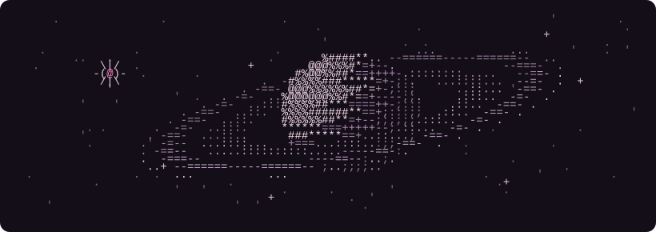

# Caio Augusto

**Software engineering · Electronics · UX/UI design**



I started programming in C++ on Arduino and hold degrees in electronics and software engineering. I'm interested in connected devices and the interfaces people use to control them.

**On my radar** · `Python` · `JavaScript` · `REST APIs` · `SQL`

## Featured project

**[GiraSolar Energy](https://github.com/CaioAugust/GiraSolar_Energy)** · Arduino Uno / C++

A dual-axis solar tracker that turns a small photovoltaic panel toward the strongest light.

```text
4 light sensors -> Arduino -> 2 servos
```

[Explore my repositories →](https://github.com/CaioAugust?tab=repositories)
